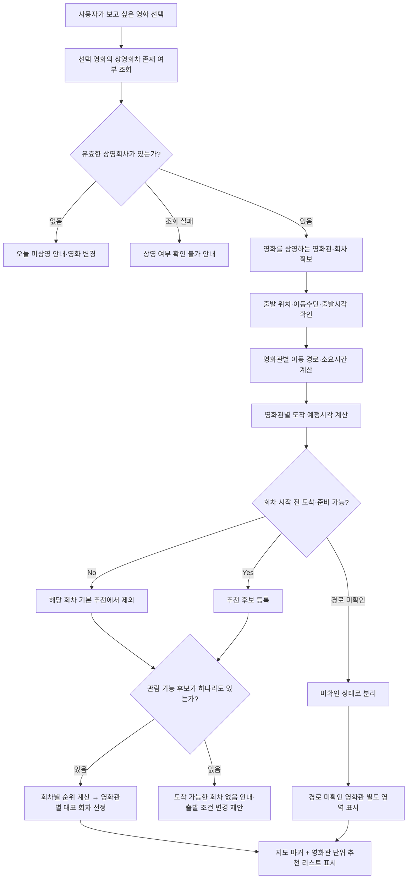

# 영화 우선 탐색·이동시간 기반 영화관 추천 서비스 요구사항 명세서

> **문서 목적:** 시스템 아키텍처 담당자가 서비스의 동작과 범위에 관한 판단을 일관되게 내릴 수 있도록 기능·데이터·품질·검증 요구사항을 정의한다. 구체적인 기술 스택과 내부 구현 방식은 아키텍처 설계에서 결정한다.
>
> **문서 버전:** v1.2 (결과 단위·우선순위·조회 기간·경로 계산 최적화 기준 정리)
> **작성일:** 2026-11-14
> **대상:** 시스템 아키텍트, 백엔드·프론트엔드 개발자, 데이터 연동 담당자
> **표기:** P0 = MVP 필수 / P1 = 후속 권장 / P2 = 장기 확장 / TBD = 협의 필요

## 1. 서비스 개요

### 1.1 서비스 정의

사용자가 **보고 싶은 영화를 먼저 선택**하면, 서비스는 **그 영화의 관람 가능한 상영회차가 존재하는지 확인**하고, **해당 영화를 상영하는 영화관을 검색**한다. 이후 사용자의 **출발 위치·이동수단·출발시각**을 바탕으로 영화관별 소요시간을 계산하여 **상영 시작 전에 도착 가능한 영화관·회차를 추천**한다. 결과는 **지도와 추천 리스트**로 제공한다.

### 1.2 해결하려는 문제

기존 영화 예매 흐름에서는 사용자가 영화관별로 원하는 영화의 상영 여부를 확인한 뒤, 각 영화관의 상영시간과 이동시간을 별도로 비교해야 한다. 본 서비스는 **영화 중심으로 상영관을 탐색**하고, 이동시간과 상영시간을 통합해 **지금 또는 지정한 시간에 관람하기 좋은 선택지**를 제시한다.

### 1.3 반드시 지켜야 할 서비스 원칙

1. **영화 우선:** 검색의 시작점은 사용자가 선택한 영화이다. 그 영화의 상영회차를 기준으로 영화관 후보를 확보한다.
2. **검색 반경 없음:** 사용자가 km 단위 검색 반경을 지정하지 않는다. 임의의 5/10/20km 등 **직선거리 반경으로 영화관을 검색 단계에서 제외하지 않는다.**
3. **상영관 후보의 기준:** 서비스가 확보한 상영시간표 데이터의 **지원 범위 내에서**, 선택 영화의 유효한 상영회차가 있는 모든 영화관이 검색 대상이다. 지원하지 않는 지역·브랜드는 데이터 제공 범위를 명확히 알린다.
4. **이동시간에 따른 추천:** 후보 영화관을 확보한 **이후** 출발 조건과 경로를 적용하여 관람 가능 여부를 판정하고 순위를 매긴다.
5. **판정은 회차 단위, 표시는 영화관 단위:** 관람 가능 판정과 순위 계산은 **특정 영화관의 특정 회차** 단위로 한다. 지도와 추천 리스트는 **영화관 단위**로 표시하며, 각 영화관은 현재 정렬 기준의 최상위 관람 가능 회차(대표 회차)로 대표된다.
6. **사실과 추정 구분:** `도착 가능`은 이동시간 기준의 판단이며 `잔여 좌석 있음` 또는 `예매 가능`을 뜻하지 않는다.

### 1.4 용어 정의

- **조회 기준 기간(MVP):** **오늘**의 영업일. 자정 이후 시작하는 심야 회차(예: 시간표상 `25:10`)는 해당 영업일에 포함하고, 실제 시각은 다음 날 01:10으로 변환해 계산한다. 다른 날짜 선택은 P1이다.
- **상영 중인 영화:** 조회 기준 기간에 **요청 시점 이후 시작하는 유효 상영회차가 한 개 이상 확인된 영화**. 이미 시작해 진행 중인 회차는 신규 관람 추천 대상이 아니다.
- **대표 회차:** 한 영화관의 관람 가능 회차 중 현재 정렬 기준으로 가장 순위가 높은 회차.
- **상영 영화관:** 해당 영화의 유효 상영회차가 하나 이상 확인된 영화관.
- **지원 범위:** 실제로 상영시간표를 확보할 수 있는 영화관 브랜드·지점·지역 및 날짜 범위. 전국 모든 영화관에 대한 완전한 수집을 보장한다는 의미가 아니다.
- **관람 가능 회차:** 출발시각, 이동시간, 입장 준비시간을 고려했을 때 상영 시작 전까지 도착·준비할 수 있는 회차.
- **이동시간 미확인:** 경로 데이터를 확보하지 못하여 도착 가능성을 판정할 수 없는 상태. `도착 불가`와 구분한다.

## 2. 사용자 이용 흐름

### 2.1 기본 사용자 시나리오 (P0)

1. 사용자는 영화 제목을 검색하거나 **상영 중인 영화 목록**에서 보고 싶은 영화를 선택한다.
2. 서비스는 선택 영화의 **유효한 상영회차 존재 여부**를 확인한다.
   - 존재: 해당 영화를 상영하는 영화관·상영회차를 후보로 확보한다.
   - 없음: `오늘 확인된 상영회차가 없습니다`를 안내하고 다른 영화를 선택하도록 한다.
   - 데이터 조회 실패/미확보: `상영 여부를 확인할 수 없습니다`로 구별한다.
3. 사용자는 현재 위치를 허용하거나 주소·장소를 검색해 출발 위치를 설정한다.
4. 사용자는 이동수단(자동차·대중교통·도보) 및 출발시각(기본값 `지금`)을 선택한다.
5. 서비스는 **선택 영화가 상영되는 영화관들에 대해** 이동 경로·소요시간을 계산한다.
6. 서비스는 영화관별 예상 도착시각과 회차별 상영 시작시각을 비교하여 **관람 가능한 회차**를 선별한다.
7. 서비스는 선택한 정렬 기준으로 회차별 순위를 계산하고, 영화관마다 대표 회차를 정해 영화관 단위로 추천한다.
8. 사용자는 지도와 리스트에서 영화관별 대표 회차의 이동시간, 상영시각, 대기시간을 비교한다.
9. 사용자는 영화관을 선택해 같은 영화관의 다른 관람 가능 회차를 확인하고, 원하는 회차의 길찾기 또는 확보된 공식 예매 페이지로 이동한다.

> **핵심 순서:** 영화 선택 → 영화의 상영 여부 확인 → 해당 영화를 상영하는 영화관/회차 확보 → 출발 조건 확인 → 이동시간 계산 → 도착 가능 여부 판단 → 추천.
>
> **검색 반경 선택 UI는 제공하지 않는다.** 근처 영화관을 미리 추려 검색하는 서비스가 아니라, 영화의 상영 여부로 검색한 결과를 이동시간으로 평가하는 서비스이다.

### 2.2 추천 처리 흐름도



### 2.3 검색·추천 범위의 해석

- **영화 검색 단계:** 상영시간표가 확보된 전체 지원 영화관 데이터에서 **선택 영화의 상영회차**를 찾는다. 출발지로부터의 직선거리를 검색 조건으로 사용하지 않는다.
- **추천 단계:** 출발 위치, 이동수단, 출발시각을 바탕으로 **영화관별 실제 예상 이동시간**을 적용한다.
- **결과 단계:** 기본 지도·리스트에는 **관람 가능 회차가 있는 영화관만** 대표 회차와 함께 표시한다. 도착 불가 회차는 기본 목록에서 제외하되, 영화관 상세에서 `도착 불가`로 구분해 볼 수 있다. 경로 미확인 영화관은 별도 영역에 표시한다. 결과가 어떤 지원 범위에서 계산되었는지 함께 표시한다.
- **구현 최적화 허용:** 비용 절감을 위해 경로 조회 순서 최적화, 중복 제거, 병렬 처리, 캐싱, 단계적 계산을 적용할 수 있다. 단, **거리 기반의 숨겨진 고정 반경을 서비스 검색 조건으로 도입해서는 안 된다.** 일부 후보만 계산한 경우 결과가 부분적임을 명시하며, 미계산 후보를 `도착 불가`로 단정하지 않는다. 단, 4.4의 하한 판정으로 불가능이 증명된 후보는 `도착 불가`로 분류할 수 있다.

## 3. 기능 요구사항

### 3.1 영화 선택 및 상영 여부 확인

| ID | 우선순위 | 요구사항 | 수용 조건 |
|---|---|---|---|
| FR-01 | P0 | 영화 목록·제목 검색 제공 | 사용자가 보고 싶은 영화를 제목으로 검색하거나 목록에서 선택할 수 있다. |
| FR-02 | P0 | 영화 선택을 탐색 시작점으로 사용 | 영화가 선택되기 전에는 특정 영화관을 중심으로 추천 탐색을 시작하지 않는다. |
| FR-03 | P0 | 선택 영화의 상영 여부 확인 | 조회 기준 날짜에 유효 상영회차가 있는지 확인하고 `상영 확인/미상영 확인/조회 불가`를 구분한다. |
| FR-04 | P0 | 출발 위치 자동·수동 설정 | 위치 권한 거부 시에도 주소·장소 검색으로 출발지를 지정할 수 있다. |
| FR-05 | P0 | 자동차·대중교통·도보 이동수단 선택 | 선택한 이동수단을 영화관별 이동시간 계산에 적용한다. |
| FR-06 | P0 | 출발시각 지정 | 기본값은 요청 시점 `지금`; **오늘 영업일 안의** 미래 출발시각을 지정할 수 있다. 오늘 마지막 회차 이후의 출발시각은 선택할 수 없다. **검색 반경 입력은 없다.** |
| FR-07 | P1 | 관람 날짜·시간대 선택 | 지정된 관람일 또는 시간대의 유효 회차만 후보에 포함한다. 기본 정책은 `오늘`이다. |

### 3.2 해당 영화를 상영하는 영화관·회차 검색

| ID | 우선순위 | 요구사항 | 수용 조건 |
|---|---|---|---|
| FR-08 | P0 | 영화 중심의 영화관 후보 조회 | **선택 영화의 유효 상영회차가 존재하는 모든 지원 영화관**을 후보로 식별한다. 출발지 반경으로 제외하지 않는다. |
| FR-09 | P0 | 해당 영화의 영화관별 상영회차 조회 | 영화관별 시작시각·회차 식별자·상영관 정보(가능한 경우)를 가져온다. |
| FR-10 | P0 | 외부 데이터 ID 정규화 | 영화·영화관·회차의 서로 다른 제공처 식별자를 내부 표준 ID에 대응시킨다. |
| FR-11 | P0 | 데이터 출처·갱신 상태 관리 | 상영 확인·미상영 확인·조회 실패·부분 수집·정보 노후화를 구분하고 출처·갱신시각을 기록한다. |
| FR-12 | P0 | 같은 영화관의 다른 회차 표시 | 영화관 상세에서 대표 회차 외 다른 관람 가능 회차를 시작시각 순으로 확인할 수 있다. 리스트 항목에는 `14:40 외 2개 회차`처럼 다른 회차 수를 표시한다. |

### 3.3 이동시간 및 도착 가능성

| ID | 우선순위 | 요구사항 | 수용 조건 |
|---|---|---|---|
| FR-13 | P0 | 상영 영화관별 예상 이동시간 조회 | 출발지·이동수단·출발시각에 따른 영화관별 이동시간을 계산한다. 검색용 반경은 적용하지 않는다. |
| FR-14 | P0 | 도착예정시각 계산 | `도착예정 = 출발시각 + 이동시간`을 계산한다. |
| FR-15 | P0 | 입장 준비 여유시간 반영 | 기본 10분(정책값) 반영 후 상영 시작 전까지 준비가 가능한지 판정한다. |
| FR-16 | P0 | 도착 불가능한 회차 기본 추천 제외 | 이동시간을 고려하면 늦게 도착하는 회차는 추천 후보에서 제외한다. |
| FR-17 | P0 | 경로 조회 실패 상태 구분 | 이동시간 미확인 후보를 임의 값으로 추천하거나 `도착 불가`로 확정하지 않는다. |
| FR-18 | P1 | 이동수단별 추가 여유시간 | 자동차 주차, 도보 접근 등 준비시간을 이동수단에 따라 다르게 지정할 수 있다. |

### 3.4 추천·지도 및 이용 완료

| ID | 우선순위 | 요구사항 | 수용 조건 |
|---|---|---|---|
| FR-19 | P0 | 종합 추천 정렬 | 관람 가능한 회차 중 이동시간·대기시간의 가중 비용이 낮은 순으로 정렬한다. |
| FR-20 | P0 | 최단 이동 정렬 | 관람 가능한 회차 중 예상 이동시간이 짧은 순으로 정렬한다. |
| FR-21 | P0 | 빠른 관람 정렬 | 관람 가능한 회차 중 상영 시작이 빠른 순으로 정렬한다. |
| FR-22 | P0 | 지도·리스트 동일 데이터 사용 | 지도 마커 1개와 리스트 항목 1개가 같은 영화관에 1:1로 대응하고, 같은 대표 회차와 순위를 표시한다. |
| FR-23 | P0 | 추천 항목 정보 제공 | 영화관명, 위치, 이동시간, 도착예정시각, 그리고 대표 회차의 시작시각·대기·여유시간을 표시한다. |
| FR-24 | P0 | 길찾기 및 외부 예매 페이지 연결 | 선택한 영화관의 길찾기 링크와 확인된 공식 예매 링크(있는 경우)를 제공한다. |
| FR-25 | P0 | 결과 없음 유형별 안내 | `영화 미상영`, `관람 가능 회차 없음`, `경로 미확인`, `지원 데이터 부족`을 구분하여 대안을 제시한다. MVP 대안은 다른 영화·출발시각·이동수단·출발지 변경이다. **반경 확대·날짜 변경 안내는 제공하지 않는다.** |
| FR-26 | P0 | 조건 변경 후 재계산 | 영화·출발지·이동수단·출발시각·정렬기준 변경 시 결과를 갱신한다. 정렬기준만 바뀌면 경로를 다시 조회하지 않고 순위와 대표 회차만 다시 정한다. |
| FR-27 | P2 | 좌석/예매 가능 여부 연동 | 공식·제휴 데이터로 확인된 경우에만 좌석 및 예매 상태를 표시한다. |

## 4. 핵심 추천 정책과 계산 규칙

### 4.1 영화의 상영 여부 확인

상영 여부를 출발지와 관계없이 **선택 영화의 상영시간표 데이터**로 먼저 확인한다.

- **상영 확인:** 조회 기준 기간에 **요청 시점 이후 시작하는 유효 회차가 한 건 이상** 존재함이 확인됨. 상영 여부는 출발 조건을 받기 전에 확인하므로 출발시각을 사용하지 않는다. 출발시각은 4.2의 관람 가능성 판정에서만 사용한다.
- **미상영 확인:** 해당 기간과 지원 범위 내 데이터가 정상 수집되었으며 유효 회차가 없음.
- **조회 불가:** 데이터 제공처 오류, 제공 범위 미포함, 수집 실패로 유무를 확정할 수 없음.

`상영 확인`이어도 사용자가 시간 내에 도착할 영화관이 없을 수 있다. 이는 `미상영 확인`과 다른 상태이다.

### 4.2 관람 가능성 판정

```text
arrivalTime = departureTime + travelMinutes
readyTime   = arrivalTime + bufferMinutes
feasible    = (readyTime <= showtimeStart)
waitMinutes = showtimeStart - arrivalTime
spareMinutes = showtimeStart - readyTime
```

- 모든 시각은 타임존을 포함하며, 국내 초기 운영 기준은 `Asia/Seoul`이다.
- 기본 `bufferMinutes = 10`은 초기 정책값이며 확정값이 아니다. 이 값은 **서버 정책으로 관리**하며 MVP에서 사용자가 바꿀 수 없다.
- 조회 대상 날짜와 자정 경계를 정확히 처리한다.
- 상영시간표가 확인되어도 좌석·예매 가능 여부는 별도 확인이 필요하다.

**판정 예시**

- 출발 14:00 / 이동 25분 / 준비 여유 10분 → 준비 완료 14:35.
- 14:40 회차 → **추천 포함** (도착 14:25, 대기 15분, 준비 후 여유 5분).
- 14:30 회차 → **추천 제외**.

### 4.3 추천 정렬 방식

| 기준 | 1차 정렬 기준 | 설명 |
|---|---|---|
| 종합 추천(기본값) | `travelMinutes + 0.35 × waitMinutes` 오름차순 | 이동이 너무 길거나 영화까지 너무 오래 기다리는 선택지에 불이익 적용 |
| 최단 이동 | `travelMinutes` 오름차순 | 상영 전 도착 가능한 후보 중 이동 부담 최소화 |
| 빠른 관람 | `showtimeStart` 오름차순 | 가능한 한 빨리 시작하는 회차 우선 |

- 추천 계산 전에 관람 가능 여부를 필터링한다.
- 동점이면 다음 순서로 결정적으로 정렬한다.
  - 종합 추천: `showtimeStart` → `travelMinutes` → 영화관 ID → 회차 ID
  - 최단 이동: `showtimeStart` → 영화관 ID → 회차 ID
  - 빠른 관람: `travelMinutes` → 영화관 ID → 회차 ID
- 가중치 `0.35`는 잠정 정책값이며 이용 데이터에 따라 변경 가능해야 한다.
- 한 영화관에 여러 상영회차가 있으면 **회차별로 판정하고 순위를 계산**한다.

**영화관 단위 표시 규칙**

1. 관람 가능한 모든 회차에 대해 위 기준으로 순위를 계산한다.
2. 영화관마다 순위가 가장 높은 회차를 **대표 회차**로 정한다.
3. 지도와 리스트는 영화관 단위로 표시하며, **영화관 순위는 대표 회차의 순위**를 따른다.
4. 같은 영화관의 나머지 관람 가능 회차는 영화관 상세에서 보여준다(FR-12).
5. 정렬 기준이 바뀌면 대표 회차가 바뀔 수 있다.

> **예시(종합 추천, 출발 14:00):** 강남점 14:40(이동 25분·대기 15분, 비용 30.3), 강남점 16:30(이동 25분·대기 125분, 비용 68.8), 잠실점 15:00(이동 30분·대기 30분, 비용 40.5) → 리스트는 `1. 강남점 14:40 외 1개`, `2. 잠실점 15:00`.

### 4.4 외부 경로 API 비용·성능 정책

- 동일 요청에서 **동일 출발 조건 + 동일 영화관**에 대한 이동시간을 한 번 계산하고 다른 회차에 재사용한다.
- 영화관별 경로 호출은 가능한 경우 병렬화·중복 제거한다.
- 영화관 수가 많아 전체 경로 조회가 부담된다면 **호출 순서 최적화나 점진적 결과 제공**을 고려한다. 이때 일부 후보가 아직 계산되지 않았다면 `전체 영화관 중 최적`이라고 단정하지 않는다.
- **허용되는 최적화(도착 불가능 증명):** 경로 API 호출 없이 도착 불가능이 **수학적으로 확실한** 영화관은 경로 조회를 건너뛸 수 있다.
  - `lowerBoundMinutes = 직선거리 ÷ 이동수단별 최고 속도 상한`으로 이동시간 하한을 구한다. 최고 속도 상한은 실제 이동이 그보다 빠를 수 없도록 보수적으로 정한다(정책값, TBD).
  - `departureTime + lowerBoundMinutes + bufferMinutes > 그 영화관의 오늘 마지막 회차 시작시각`이면 해당 영화관은 `도착 불가`로 확정하고 경로를 조회하지 않는다.
  - 이 판정으로 제외된 영화관은 `경로 미확인`이 아니라 `도착 불가`로 분류한다.
- **허용되지 않는 것:** 회차 시각과 무관하게 정한 고정 km 반경(예: "20km 밖은 제외")으로 영화관을 빼는 것. 위의 하한 판정은 직선거리를 쓰더라도 회차 시각과 비교해 불가능을 증명하므로 허용된다.

## 5. 최소 입출력 데이터 계약

### 5.1 영화 상영 여부 조회 예시

**요청:** `GET /api/movies/{movieId}/availability?date=2026-11-14`

**응답 예시:**

```json
{
  "movieId": "movie_001",
  "date": "2026-11-14",
  "status": "showing",
  "cinemaCount": 12,
  "showtimeCount": 47,
  "coverage": "supported_cinemas",
  "lastUpdatedAt": "2026-11-14T11:45:00+09:00"
}
```

- `status` 예시: `showing | not_showing | unknown`.
- 위 건수는 예시일 뿐이며 전국 전체 영화관의 완전성을 의미하지 않는다.
- 내부 구현은 API를 하나로 합치거나 분리할 수 있지만 **영화 상영 여부 확인이 경로 계산보다 먼저 이뤄져야 한다.**
- MVP에서 `date`는 오늘 영업일만 허용한다. 생략하면 오늘로 처리하며, 다른 날짜는 P1에서 연다.

### 5.2 추천 요청 예시

**요청:** `POST /api/recommendations`

```json
{
  "movieId": "movie_001",
  "origin": {
    "latitude": 37.5,
    "longitude": 127.0
  },
  "transportMode": "transit",
  "departureTime": "2026-11-14T14:00:00+09:00",
  "sortBy": "balanced"
}
```

- `transportMode`: `car | transit | walk`
- `sortBy`: `balanced | travel | earliest`
- `origin`은 좌표만 받는다. 주소·장소 검색 결과를 좌표로 바꾸는 방식은 아키텍처 설계에서 정한다.
- `bufferMinutes`는 서버 정책값이므로 요청에 포함하지 않는다.
- **`radiusKm`, `maxDistanceKm`, `nearbyOnly` 등 사용자 지정 거리 제한 필드는 기본 요청 계약에 포함하지 않는다.**
- 관람 날짜·시간대 검색은 후속 단계에서 별도 필드로 확장 가능하다.

### 5.3 추천 결과 최소 항목

결과는 **영화관 항목의 배열**이며, 각 영화관 항목 안에 회차 목록을 담는다.

- **영화관 항목:** 영화관 ID, 영화관명·주소·좌표, 추천 순위, 이동수단, 이동시간(분), 도착예정시각, 경로 조회 상태, 길찾기 정보, 대표 회차 ID, 관람 가능 회차 수.
- **회차 항목(영화관 항목 안):** 상영회차 ID, 상영 시작시각, 대기시간, 준비 후 여유시간, 판정 결과(`도착 가능 | 도착 불가`), 공식 예매 링크(존재하는 경우).
- **경로 미확인 영화관:** 순위 목록과 분리된 별도 배열로 제공한다.
- 상영시간표·경로 데이터 조회 상태 및 갱신시각.
- 전체 응답 메타정보: `requestedAt`, `sortBy`, `coverage`, `partialFailure`, `notices` 등.

최종 API URL, 응답 스키마, 오류코드, 페이지네이션 정책은 아키텍처 설계 단계에서 확정한다.

## 6. 외부 연동 및 데이터 범위

| 데이터 | 필요 수준 | 설계 시 고려사항 |
|---|---|---|
| 영화 제목·포스터·기본 정보 | P0 | 공식·허용된 데이터 사용, 출처별 영화 ID 매핑 |
| **선택 영화의 상영회차** | **P0 / 핵심 의존성** | 영화 기준으로 영화관·회차를 조회할 수 있어야 하며 제공 범위를 추적해야 함 |
| 영화관 식별자·주소·좌표 | P0 | 영화관 브랜드 간 ID 정규화 및 중복 지점 제거 |
| 자동차·대중교통·도보 경로·이동시간 | **P0 / 핵심 의존성** | 이동수단별 지원 지역, 출발시각 반영, 쿼터·비용 확인 |
| 좌석·매진·실시간 예매 상태 | P2 | 데이터 미확보 시 해당 정보 비노출 |

**상영시간표 확보가 최우선 외부 의존성**이다. 상영시간표를 얻을 수 없는 영화관까지 조회 가능한 것처럼 표현하지 않으며, 공식 데이터/제휴/이용이 허용된 소스를 우선한다. 데이터 공급자가 바뀌어도 영화 검색·추천 로직을 유지할 수 있도록 데이터 수집 및 정규화 책임을 분리해야 한다.

MVP에서 샘플 데이터로 시연할 때는 실제 데이터와 샘플 데이터를 구별해 표시한다.

## 7. 비기능 요구사항

| ID | 구분 | 요구사항 |
|---|---|---|
| NFR-01 | 응답속도 | 초기 목표: 정상적인 외부 API 응답 조건에서 추천 결과 P95 8초 이내(잠정치). 대량 후보 처리 시 점진적 결과 제공·API 제한 대응 방안을 제안한다. |
| NFR-02 | 장애 대응 | 영화 상영 여부 조회 실패와 경로 실패를 구분한다. 일부 영화관에서 경로를 구하지 못해도 계산 가능한 결과를 제공한다. |
| NFR-03 | 데이터 신뢰성 | 상영시간표 출처·갱신시각·지원 범위를 관리하고 수집 실패를 미상영으로 오인하지 않는다. |
| NFR-04 | 개인정보 | 출발 위치를 추천 계산에 필요한 범위에서만 처리한다. 기본 정책상 정밀 좌표를 영구 저장하지 않는다. |
| NFR-05 | 보안 | HTTPS 적용, 외부 API 키 서버 보관, 입력 검증·요청 제한·오류 노출 최소화. |
| NFR-06 | 접근성 | 모바일 우선 반응형 UI와 지도 이외의 추천 목록 접근 경로를 제공한다. |
| NFR-07 | 확장성 | 영화관 브랜드·상영시간표 공급자·경로 API를 교체·추가할 수 있어야 한다. |
| NFR-08 | 관측성 | 상영회차 수집 성공률, 영화 검색 성공률, 경로 API 실패율·호출량·응답시간, 후보 수를 추적한다. |
| NFR-09 | 비용·약관 | 지도·경로·상영시간표 데이터의 이용약관, 재사용·저장 제한, API 요금·쿼터를 준수한다. |

## 8. 예외 및 오류 시나리오

| 상황 | 기대 동작 |
|---|---|
| 사용자가 선택한 영화가 조회 기준 기간에 상영하지 않음 | 해당 영화 미상영 안내 및 다른 영화 선택 제공 |
| 상영시간표 공급자 데이터가 누락되거나 실패 | `상영 여부 확인 불가`로 표시하고 `미상영`이라고 단정하지 않음 |
| 해당 영화를 상영하는 영화관이 여러 지역에 존재 | 모든 **지원 범위 내 상영 영화관**을 대상으로 후보 확보; 임의 반경 제한 없음 |
| 출발 위치 권한 거부 | 수동 위치 입력으로 계속 진행 |
| 영화관은 있지만 도착 가능한 회차가 없음 | `영화는 상영 중이나 현재 조건에서 도착 가능한 회차 없음`을 안내하고 출발시각·이동수단·출발지 변경 제안 |
| 일부 경로 API 실패 | 확인된 경로의 추천을 제공하고 미확인 영화관의 상태를 별도 안내 |
| 경로 API 비용·호출량 제한으로 일부 후보 미계산 | 부분 결과임을 표시하고 전체 후보를 평가한 것처럼 설명하지 않음 |
| 영화관별 상영회차가 여러 개 있음 | 한 영화관의 이동시간을 재사용해 모든 회차를 개별 판정하고, 대표 회차 1개로 리스트에 표시. 나머지는 상세에서 표시 |
| 예매 링크 또는 좌석 정보가 없음 | 도착 가능 정보와 별도로 표시; 예매 가능 여부를 보장하지 않음 |
| 지도 렌더링 실패 | 리스트를 이용해 추천 결과를 계속 확인할 수 있어야 함 |

## 9. MVP 범위와 제외 범위

### 9.1 MVP(P0) 필수

- 영화 목록·검색·선택.
- 선택 영화의 상영 여부 확인.
- **해당 영화를 상영하는 영화관 및 회차 검색(반경 제한 없음).**
- 출발 위치 자동·수동 지정, 이동수단·출발시각 지정.
- 조회 기간은 오늘 영업일(심야 회차 포함).
- 영화관별 이동시간 계산과 회차별 관람 가능 판정.
- 종합 추천·최단 이동·빠른 관람 정렬, 조건·정렬 변경 시 재계산.
- 영화관 단위 지도·목록 표시(대표 회차), 영화관 상세의 다른 회차 표시.
- 길찾기 및 가능한 공식 예매 페이지 연결.
- 상영 여부·지원 범위·외부 API 실패에 따른 예외 처리.

### 9.2 후속(P1)

관람 날짜·시간대 선택(FR-07), 이동수단별 추가 여유시간(FR-18), 검색 조건 저장, 데이터 운영 현황 모니터링. 검색 조건 저장과 운영 모니터링은 P1 착수 시 FR로 정의한다.

### 9.3 장기 확장(P2)

실시간 좌석·매진 연동, 개인화 추천, 여러 명의 출발지 최적화, 서비스 내 예매·결제, 주차/혼잡도 반영.

> **MVP 시연 범위:** 실제 상영시간표가 확보되지 않더라도, 명확히 표시된 샘플 상영시간표를 사용해 **영화 검색 → 영화관 후보 → 경로 계산 → 추천**의 전체 흐름을 검증할 수 있다.

## 10. 인수 테스트 (Acceptance Criteria)

| ID | 입력·상황 | 기대 결과 |
|---|---|---|
| AT-01 | 영화 A에 대해 지원 범위 내 3개 영화관의 유효 회차가 있음 | 출발지와 관계없이 **세 영화관 모두 영화 후보로 확보**함 |
| AT-02 | AT-01 중 한 영화관이 출발지에서 20km 이상 떨어짐 | **고정 거리 반경 때문에 후보 조회 단계에서 제외되지 않음** |
| AT-03 | 선택 영화의 유효 회차가 없음 | 이동경로를 계산하지 않고 `미상영` 안내 |
| AT-04 | 상영시간표 조회 자체가 실패 | `상영 여부 확인 불가` 처리; `미상영`으로 오판하지 않음 |
| AT-05 | 위치 권한 거부 후 주소를 직접 선택 | 추천 과정 계속 진행 |
| AT-06 | 출발 14:00 / 이동 25분 / 여유 10분 / 상영 14:40 | 후보 포함, 도착 14:25, 대기 15분, 준비 후 여유 5분 |
| AT-07 | AT-06과 같고 상영만 14:30 | 해당 회차 제외 |
| AT-08 | 동일 영화관에 14:40·16:30 회차 존재 | 영화관 이동시간 1회 계산 후 각각 도착 가능 여부 판정 |
| AT-09 | 영화 B는 상영 중이나 모든 회차에 늦음 | `미상영`이 아니라 `도착 가능한 회차 없음` 안내 |
| AT-10 | 대중교통에서 자차로 이동수단 변경 | 변경된 이동시간으로 관람 가능성·순위 재계산 |
| AT-11 | 일부 영화관 경로 조회 실패 | 해당 영화관은 경로 미확인으로 구분, 계산된 결과만 정상 추천 |
| AT-12 | 정렬을 최단 이동에서 빠른 관람으로 변경 | 같은 관람 가능 후보에서 해당 기준으로 재정렬 |
| AT-13 | 일부 영화관 미지원 또는 수집 실패 | 지원 범위·부분 데이터 상태가 사용자에게 구분되어 전달 |
| AT-14 | 예매·좌석 정보가 없음 | `예매 가능` 또는 `좌석 있음`이라고 단정하지 않음 |
| AT-15 | 강남점 14:40·16:30, 잠실점 15:00이 모두 관람 가능(4.3 예시) | 리스트는 2개 항목(`강남점 14:40 외 1개`, `잠실점 15:00`), 지도 마커도 2개이며 순서가 같음 |
| AT-16 | AT-15 상태에서 강남점 상세 열기 | 14:40·16:30 회차가 시작시각 순으로 표시됨 |
| AT-17 | 정렬 기준만 변경 | 경로 API를 다시 호출하지 않고 대표 회차와 순위만 갱신 |
| AT-18 | 출발 21:00, 직선거리 300km 영화관의 오늘 마지막 회차가 23:00 | 경로 API 호출 없이 `도착 불가`로 분류. `경로 미확인`으로 표시하지 않음 |
| AT-19 | 시간표상 `25:10` 회차 | 오늘 영업일 회차로 포함하고 다음 날 01:10으로 계산 |
| AT-20 | 내일 날짜로 출발시각 지정 시도 | MVP에서는 선택 불가 |

## 11. 아키텍처 담당자에게 요청하는 산출물

1. **시스템 컨텍스트 다이어그램:** 사용자, Frontend, Backend, 상영시간표 데이터 공급자, 지도/경로 API, DB 관계.
2. **컴포넌트 다이어그램:** 영화 검색·상영 여부 확인, 상영 영화관 후보 탐색, 이동시간 계산, 관람 가능성 판정, 추천, 결과 제공 책임 분리.
3. **시퀀스 다이어그램:** **영화 선택 및 상영 여부 확인이 경로 조회보다 먼저 진행되는 순서**와 실패 분기.
4. **데이터 모델(ERD):** 영화·영화관·상영회차·외부 ID 매핑·수집 상태·지원 범위.
5. **API 계약:** 영화 상영 여부 조회 API, 추천 API, 시간·좌표·오류·부분 실패 응답.
6. **데이터 연동·갱신 아키텍처:** 영화별 상영 영화관 검색을 위한 정규화·인덱싱·동기화 방식.
7. **대규모 후보 대응 설계:** **검색 반경을 도입하지 않으면서도** 경로 API 호출량·비용·응답속도를 관리할 최적화 방안 및 정확성/완전성 표시.
8. **보안·개인정보 설계:** 출발 위치 처리, API 키 보관, 로그와 보존 정책.
9. **배포 및 MVP 개발 계획:** 단계별 구축, 샘플 상영회차 → 실제 연동으로 전환하는 경로.

## 12. 설계 착수 전 미확정 사항 (TBD)

| 항목 | 현재 가정 | 결정 주체 |
|---|---|---|
| 상영시간표 확보 방법 | 공식/허용된 데이터 우선, 미확보 시 샘플 MVP | 기획·데이터 담당 |
| 최초 지원 영화관·지역 | **데이터를 확보한 지원 범위 전체**에서 영화 중심 검색; 임의 거리 반경 없음 | 기획·데이터 담당 |
| 조회 대상 기간 | **확정(v1.2):** MVP는 오늘 영업일의 남은 유효 회차(심야 회차 포함); 날짜 지정은 P1 | 기획 |
| 경로 API 지원 수단 | 자동차·대중교통·도보 목표 | 기술·데이터 담당 |
| 많은 영화관의 경로 계산 정책 | 캐싱·병렬 처리·단계적 계산; 미계산 후보/부분 결과 표시 | 아키텍트 |
| 입장 준비시간 | 기본 10분(서버 정책값), 향후 이동수단별 조정 | 기획 |
| 최대 대기시간 | 미정. 도착 후 너무 오래 기다리는 회차를 후보에서 뺄지, 뺀다면 몇 분부터인지 | 기획 |
| 이동수단별 최고 속도 상한 | 4.4의 도착 불가 증명용. 실제보다 빠르게 보수적으로 설정 | 아키텍트·데이터 담당 |
| 오래된 시간표 기준 | 미정. 갱신 후 몇 시간이 지나면 `정보 노후화`로 표시할지 | 기획·데이터 담당 |
| 종합 추천 가중치 | 이동 1.0, 대기 0.35 | 기획 |
| 응답속도 목표 | P95 8초(잠정), 경로 API 제약에 따라 협의 | 아키텍트·기획 |
| 예매 페이지 연결 | 확보된 공식 예매 링크만 직접 연결 | 기획·제휴 담당 |

---

### 한 문장으로 정리한 핵심 요구사항

**“사용자가 선택한 영화가 상영 중인지 먼저 확인하고, 해당 영화를 상영하는 지원 영화관들을 거리 반경으로 제한하지 않고 탐색한 뒤, 출발 위치와 이동수단에 따른 실제 이동시간을 적용해 상영 시작 전 도착 가능한 회차를 추천한다.”**
